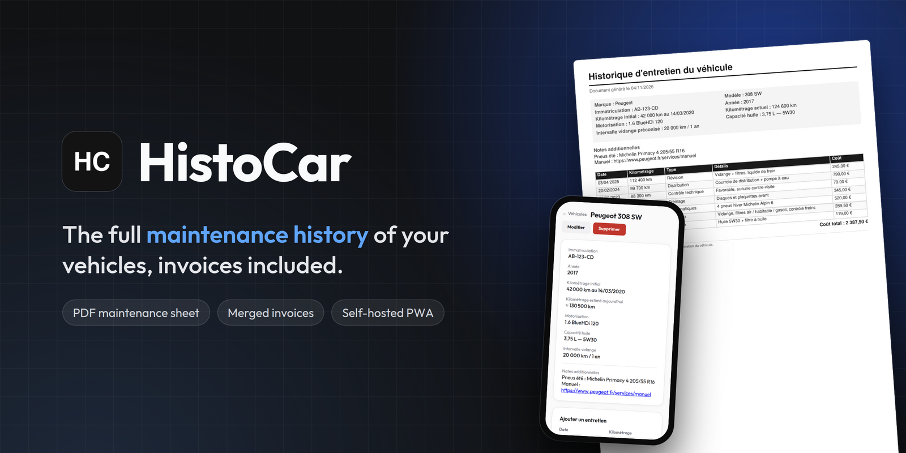
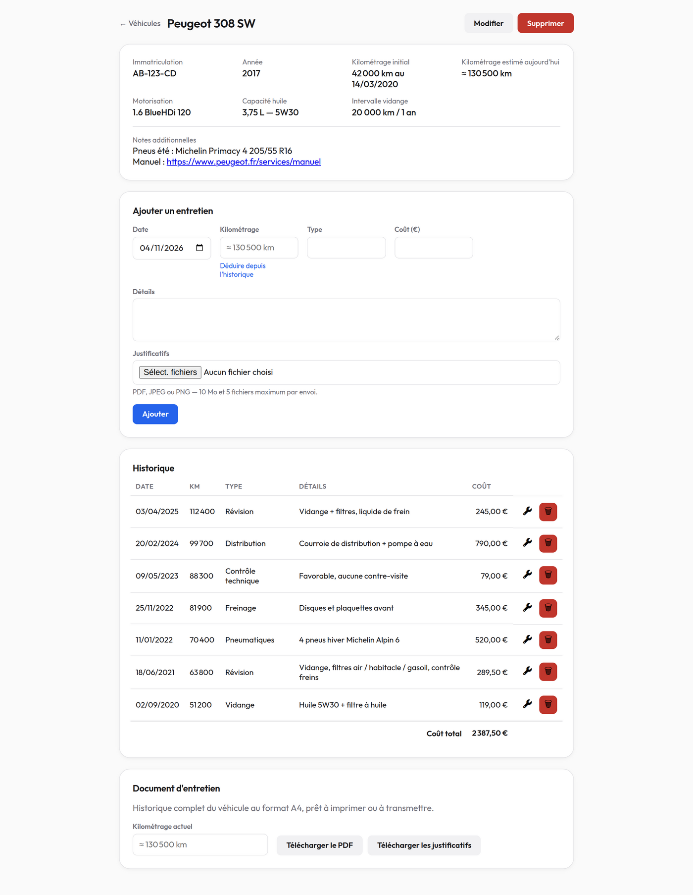
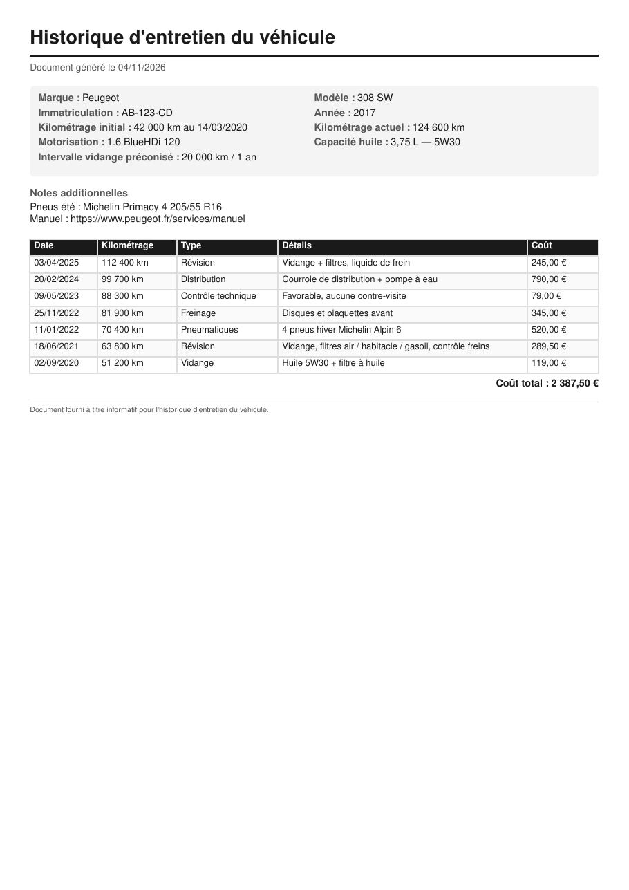
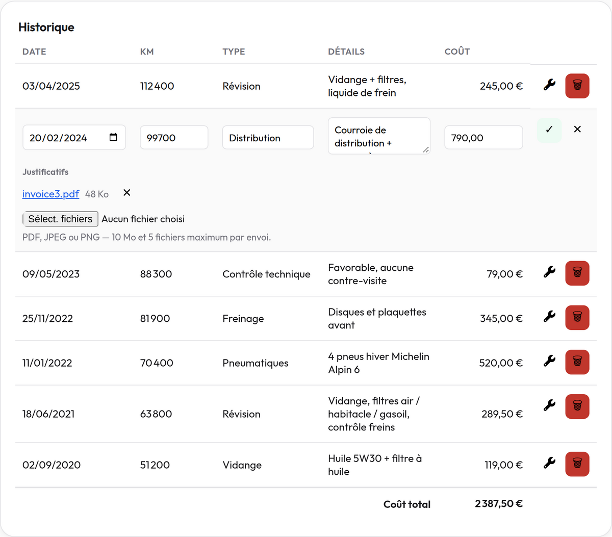
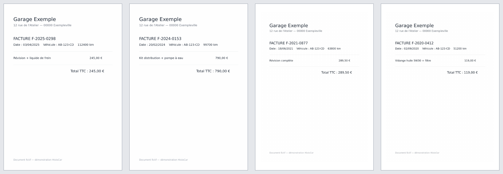
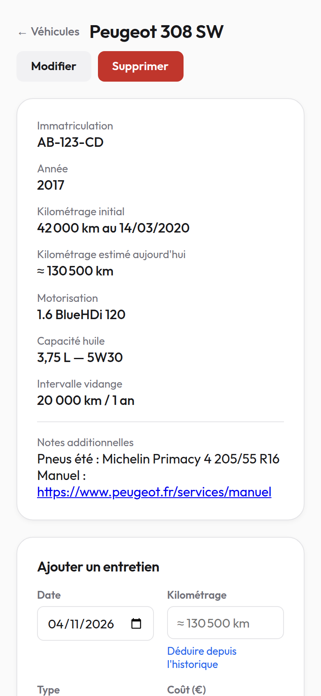

# HistoCar

Log each service with its date, mileage and cost, attach the invoices (PDF, JPEG, PNG), and download per vehicle an A4 maintenance sheet plus one PDF merging all its invoices. Handy when selling a car.

Multi-user, invite-only sign-up. The UI and the generated PDFs are in French.

## Screenshots



| Maintenance sheet (generated PDF) | Invoices attached to a record |
|---|---|
|  |  |

**All invoices merged into one PDF**: PDF pages are copied as-is, each image gets its own A4 page.



<p align="center">
  
</p>

<sub>Demo data: the vehicle, plate and garage are fictional.</sub>

**Stack**: npm workspaces monorepo — `packages/server` (Express, Prisma, PostgreSQL, pdfkit, pdf-lib, sharp) and `packages/web` (React, Vite, vite-plugin-pwa). Docker Compose for dev and prod, optional Cloudflare Tunnel for public exposure.

## Requirements

- Docker with Compose v2
- Node.js 22 + npm (only for running lint, typecheck and tests on the host)
- `make`

## Quick start (development)

```bash
git clone --recurse-submodules https://github.com/nmetahri/HistoCar.git
cd HistoCar
make setup   # creates .env from .env.dist, installs dependencies, generates the Prisma client
make dev     # db + API (:3001) + Vite (:5173)
```

Open http://localhost:5173. Registration requires an invite code: set `SIGNUP_INVITE_CODE` in `.env` (left empty, sign-ups are closed), then restart the stack.

`make help` lists every command. `make verify` runs lint, typecheck and tests.

## Production

1. Fill `.env` with real values: `POSTGRES_PASSWORD` (also in `DATABASE_URL`), a long random `JWT_SECRET` (`openssl rand -hex 32`), `WEB_ORIGIN` set to your public URL, and `SIGNUP_INVITE_CODE`. Compose interpolates `$` in `.env`: write `$$` for a literal `$`.
2. Set up the Cloudflare Tunnel, which is the only public entry point:

   ```bash
   git submodule update --init
   cloudflared tunnel login
   cloudflared tunnel create histocar-tunnel          # prints the UUID, writes ~/.cloudflared/<UUID>.json
   cp ~/.cloudflared/<UUID>.json cloudflared/
   cloudflared tunnel route dns histocar-tunnel histocar.<your-domain>
   cp cloudflared/config.example.yaml cloudflared/config.yaml
   # set your hostname in cloudflared/config.yaml, and TUNNEL_UUID=<UUID> in .env
   ```

3. `make up-prod` — the app is also reachable locally on http://localhost:8080.

Updates: `make update-prod`. Invoices live in the `uploads_data` volume and their metadata in `db_data`: back up both together.

Without Cloudflare, drop the `include:` and the `cloudflared-tunnel` service from `docker-compose.yml`, and put your own TLS reverse proxy in front of port 8080 (the auth cookie is `Secure` in production, so HTTPS is required outside `localhost`).

## Contributing

Architecture, conventions and pitfalls are documented in [CLAUDE.md](CLAUDE.md).

## License

[MIT](LICENSE)
